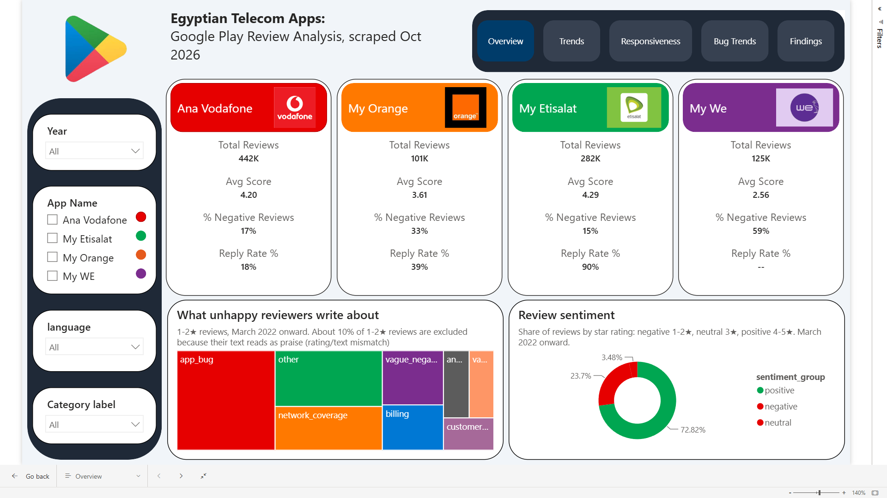
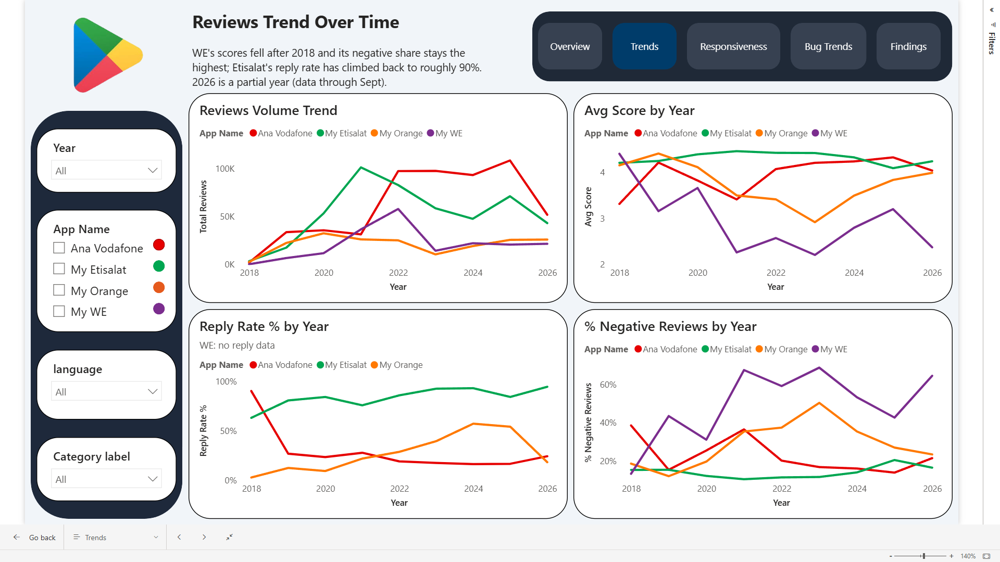
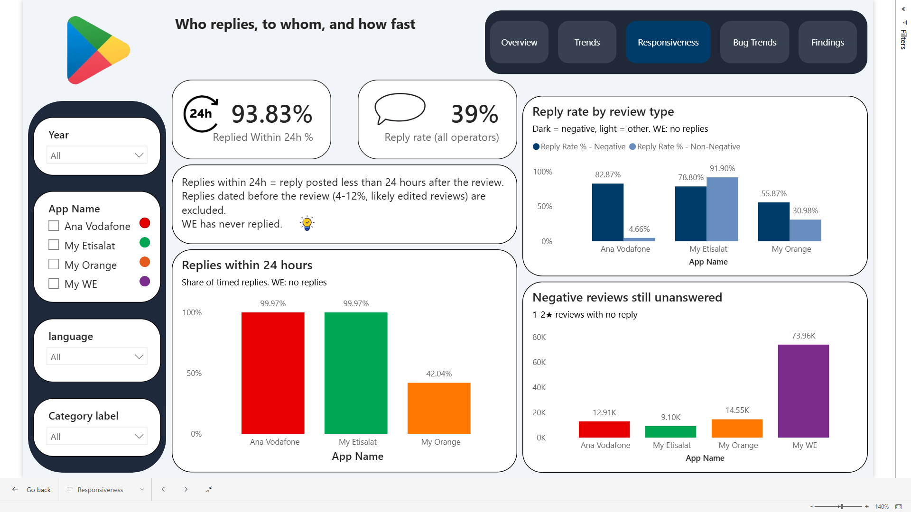
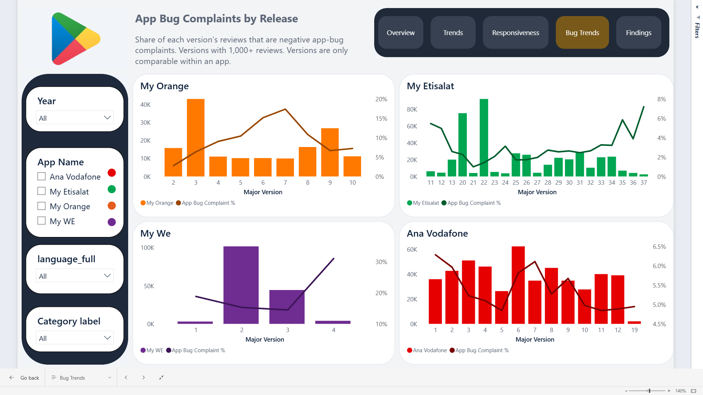
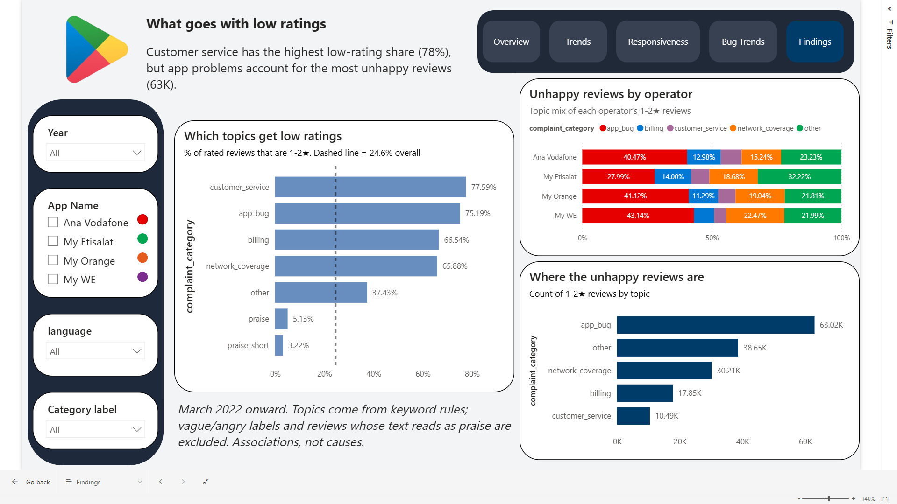

# Egyptian Telecom Apps: Google Play Review Analysis

An end-to-end analytics project built on 1.41M Google Play reviews of the four Egyptian telecom apps (Ana Vodafone, My Orange, My Etisalat and My WE), scraped in October 2026. It goes from a multi-angle scraper to a bronze/silver pipeline in Python and then to a five-page Power BI dashboard. Reviews are in Arabic, Franco-Arabic and English.

---

## What the project answers

- Who replies to reviews, to which reviews, and how fast?
- Does replying work, or can this data not tell us?
- Which topics go with low ratings, and which topics hold the most unhappy reviews?
- How reliable is a keyword classifier on Egyptian Arabic, and what did it get wrong?

## Headline results (March 2022 onward)

| Metric | Value |
|---|---|
| Reviews analysed | 1,413,967 (950,160 in the comparison window) |
| Share of reviews rated 1-2 stars | Vodafone 17%, Etisalat 15%, Orange 33%, WE 59% |
| Reply rate to negative / other reviews | Vodafone 83% / 5%, Etisalat 79% / 92%, Orange 56% / 31%, WE 0% / 0% |
| Replies posted within 24 hours | Vodafone 99.97%, Etisalat 99.97%, Orange 42.04% |
| Unanswered 1-2 star reviews | WE 73,960, Orange 14,550, Vodafone 12,910, Etisalat 9,100 |
| Low-rating share by topic (24.6% overall) | Customer service 77.6%, app problems 75.2%, billing 66.5%, network 65.9% |
| Largest group of unhappy reviews | App problems, 63K reviews |

Reply speed is measured on replies that have a valid timestamp. About 12% of Vodafone's, 6% of Orange's and 4% of Etisalat's replies are dated before the review (likely edited reviews) and are left out.

The main takeaway is that replies are targeted, so reply status cannot tell us whether replying helps. Vodafone is 99 times more likely (in odds) to reply to a negative review than to another review. Etisalat shows the opposite pattern (odds ratio 0.33), and Orange sits in between (2.8). WE has never replied.

---

## Dashboard

**Overview**: one card per operator (reviews, average score, % negative, reply rate), the topic mix of unhappy reviews, and review sentiment.



---

**Trends**: reviews, score, reply rate and % negative by year, 2018 to 2026. Vodafone before March 2022 comes from a relevance-sorted sample, so its early years are not comparable.



---

**Responsiveness**: reply rate by review type, replies within 24 hours, and the unanswered negative backlog.



---

**Bug Trends**: the share of each app version's reviews that are negative app-bug complaints, for versions with 1,000+ reviews.



---

**Findings**: which topics go with low ratings, where the unhappy reviews are, and the topic mix by operator.



---

## Architecture

```
Google Play (four apps, several sort orders per app)
   |
   v
bronze   raw parquet files, one per app and language
   |
   v
silver   cleaned and enriched reviews, one row per review
   |        reviews_raw      full raw archive, so re-runs are safe
   |        reviews_private  adds review text (kept local)
   |        reviews_public   no text, this feeds Power BI
   v
Power BI dashboard
```

## Repository structure

| File | What it does |
|---|---|
| `scrape_operators.py` | Pass 1: Arabic reviews, newest first, with retries and checkpoints. Saves parquet files to `bronze/` |
| `scrape_multi_sort.py` | Pass 2: newest, most relevant and rating sorts in Arabic and English, to reach older reviews and Franco-Arabic text |
| `silver_clean_v7.2.py` | Deduplicates, cleans and classifies the reviews and writes the silver files (v7.2) |
| `requirements.txt` | Python packages needed to run the scripts |
| `sample_reviews_public.csv` | 2,000 random rows of the dashboard source, so the data can be inspected without running anything |
| `Telecom_DAX_Measures.dax` | The dashboard measures, each with a plain-English comment and the value to expect |
| `docs/Classifier_Audit.md` | The two classifier audits, the fixes and what is still wrong |
| `Assets/` | Dashboard screenshots used in this README |

The pipeline writes `bronze/` (raw scrapes), `silver/reviews_raw.parquet` (raw archive), `silver/reviews_private.parquet` (with review text), `silver/reviews_public.csv` and `.parquet` (no text, the dashboard source) and `silver/pipeline_log.json` (row counts at every step). None of these are in the repository: the raw and private files contain review text, and the full public file is 200 MB. The Power BI report file is not included either.

## Scraping

Google Play only returns a limited number of reviews per sort order, and a newest-first scrape stopped at March 2022 for Vodafone. So I scrape in two passes with the `google-play-scraper` library:

1. `scrape_operators.py`: Arabic reviews, newest first, with retries and checkpoints.
2. `scrape_multi_sort.py`: three sort orders (newest, most relevant, rating) in two languages (Arabic and English, which also catches Franco-Arabic text), so six queries per app.

The silver pipeline loads every bronze file and de-duplicates on `reviewId`. The old Vodafone reviews that came from the extra pass are a sample of the most-helpful reviews, not a full history. That is why the comparison window starts at 10 March 2022, the point where all four apps have complete chronological data.

## Data cleaning

The silver pipeline applies these rules:

- Removed duplicate `reviewId` rows, keeping the copy that has a reply.
- Dropped rows with an invalid review date.
- Kept rating-only reviews and flagged them with `has_text`.
- Removed phone numbers, e-mail addresses and long numbers from the text.
- Flagged future-dated reviews (`is_future_dated`) and the comparison window (`in_common_window`).
- Calculated reply lag in days and set it to blank when the reply is dated before the review.
- Added a hashed `review_key`, so the public file has no raw review ID.

## Classifying complaints

Every review gets one `complaint_category` from keyword rules: network, billing, app bug, customer service, praise, vague negative, angry, or other. The rules handle Arabic spelling variants, Franco-Arabic and English words.

I audited the classifier twice, and each audit led to fixes:

| Audit | Finding | Fix |
|---|---|---|
| 50 reviews (5 per category) | 31 correct, 8 ambiguous, 11 wrong. `app_bug` was 0 of 5: the generic words "app" and "program" matched praise like "great app" | Praise guard: `app_bug` reviews with a praise word and no problem word become `praise`. 76,524 reviews moved, and the `app_bug` low-rating share went from 43.5% to 74.7% |
| 80 reviews from `other` | "جدا" (very) was counted as praise, so "very bad" became praise_short. Arabic prefixes (و، ب، ل، ال) stopped keywords matching. Emoji-only reviews and common typos were missed | Removed the intensifier, allowed one prefix on Arabic keywords, added an emoji rule and about 50 words. Low-rated `praise_short` reviews fell 32%, and rated reviews in `other` fell from 16% to 11% |

I stopped tuning after the second round. About 9% of the 80 audited `other` reviews (7 of 80) had a star rating that contradicts the text (a 5-star "very bad"), which is label noise, not a classifier error. The full write-up is in [`docs/Classifier_Audit.md`](docs/Classifier_Audit.md).

## Data model

One flat table of reviews with small dimension tables.

- **Fact:** `reviews_public`, one row per review.
- **Dimensions:** `dim_operator`, `dim_date`, `dim_language`, `dim_category`.
- **Support:** `_Measures`.

## Measures

The main measures are Total Reviews, Avg Score, % Negative Reviews, Reply Rate %, Reply Rate % - Negative, Reply Rate % - Non-Negative, Negative Reviews - Not Replied, Replied Within 24h %, Low Rating %, App Bug Complaint % and Topic Share of Operator. They are all in [`Telecom_DAX_Measures.dax`](Telecom_DAX_Measures.dax), with a short comment on each and the value you should see on the dashboard.

Some things I ran into:

- In DAX a blank equals both 0 and FALSE, so a "blank flag" measure silently counted every not-replied review. The reply-lag measure now uses `NOT ISBLANK`.
- The Power Query CSV step hard-codes `Columns=18`. When the pipeline added columns, the refresh failed on a column that was "not found" until I changed the number.
- Word-boundary matching fixed false keyword hits but broke Arabic words with a prefix. The audits found both effects.
- Printing Arabic or the star character on a Windows console crashes Python with cp1252. I write reports to UTF-8 files instead.
- Percentage-share measures need `ALLSELECTED` so that each operator's bar adds up to 100% of the topics on screen.

## Limitations

- Replies are targeted, so ratings of replied and unreplied reviews are not comparable. The data can show who gets replies, not whether replying helps.
- Play Store reviews are mostly about the app, so app problems dominate by construction. They do not prove the app is worse than the network.
- Topics come from keyword rules with one label per review. A review about billing and the app gets a single label, and "other" still holds 11% of rated reviews.
- Vodafone reviews before March 2022 are a relevance-sorted sample.
- Reply timestamps that precede the review are excluded, and this is most of what separates the 24-hour numbers from a raw count.
- WE has no replies at all, so it is excluded from reply analysis.
- 2026 is a partial year.

## How to run

1. Install the requirements: `pip install -r requirements.txt` (pandas, pyarrow and google-play-scraper).
2. Run `scrape_operators.py` and then `scrape_multi_sort.py` to fill `bronze/`.
3. Run `silver_clean_v7.2.py` from the project root. It writes the files in `silver/`.
4. Load `silver/reviews_public.csv` in Power BI. If the pipeline adds columns, update the `Columns=` value in the Source step of Power Query.

To look at the data without running anything, open `sample_reviews_public.csv`.

## Tools

Python (pandas, pyarrow, regex, google-play-scraper), Power BI (DAX, Power Query), VS Code.
